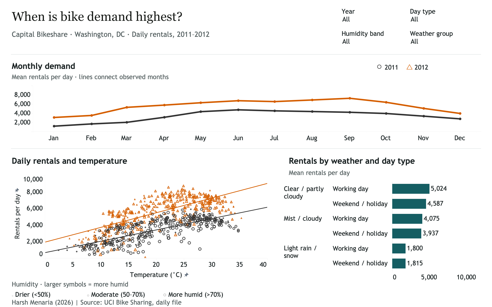
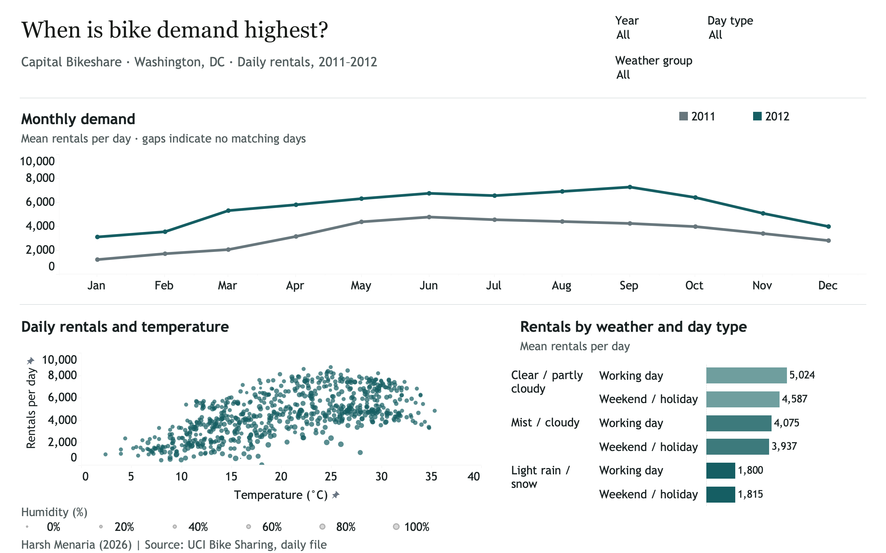
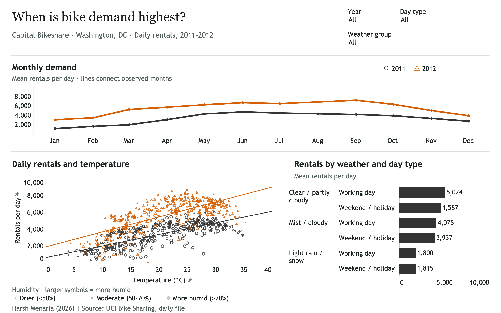
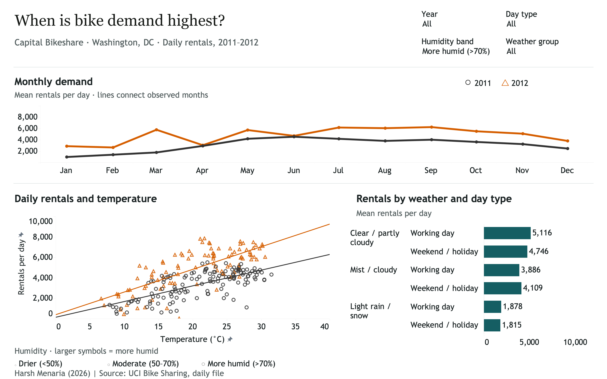
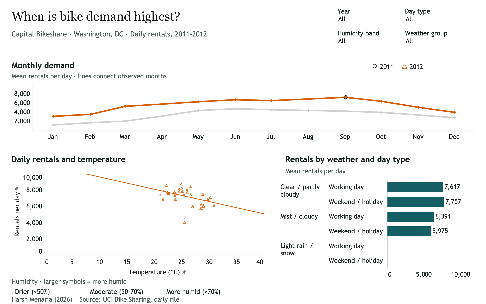

# Bike demand across time and weather

**Harsh Menaria · NYU Information Visualization · Mini-Project 2 · Final dashboard revision**

How do time of year, temperature, weather and day type relate to daily bike-rental demand, and how do the patterns differ between 2011 and 2012? Three coordinated Tableau views explore **731 daily Capital Bikeshare records from Washington, DC**.

## View the dashboard

### [Open the interactive Tableau dashboard →](https://public.tableau.com/views/BikeDemandacrossTimeandWeather-Prototype/BikedemandPrototype?:showVizHome=no&:toolbar=yes)

**No Tableau installation, account or sign-in is needed to view it.** GitHub holds the workbook, documentation and images; Tableau Public runs the interactions. Use a desktop/laptop. The dashboard has a fixed 1440 × 900 layout; use Tableau's **Full Screen** control or browser zoom if an edge is hidden. A separate mobile layout has not been implemented.

## Try it in one minute

1. Start with **Year, Day type, Humidity band and Weather group** set to **(All)**.
2. Choose **More humid (>70%)** under Humidity band. All three views update to those **231 days**. Symbol sizes stay fixed when filtering; exact humidity remains in hover details.
3. Return Humidity band to **(All)**. Click the **September 2012** point on the orange monthly line. The daily and weather views update to its **30 days**.
4. Click blank plot space in the **monthly chart** to clear that selection.
5. Click the **Weekend / holiday** bar under **Light rain / snow**. The monthly and daily charts show the **five matching days**. Hover the bar: **1,815 mean rentals per day**, **5 observed days**.
6. Click blank plot space in the **weather chart** to clear it. Hover daily symbols to inspect individual dates and conditions.

## Interactions

| Control or gesture | Result |
| --- | --- |
| **Year**: All / 2011 / 2012 | Filters every view; one year reduces overlap |
| **Humidity band**: All / Drier / Moderate / More humid | Isolates a humidity band across every view; thresholds appear in the control and key |
| **Day type** and **Weather group** | Filter every view to the selected categories |
| Click a **monthly point** | Filters the daily and weather views to that original year and month |
| Click a **daily symbol** | Filters monthly and weather views to that date |
| Click a **weather/day-type bar** | Filters monthly and daily views to that group |
| Click blank plot space in the **source chart** | Clears that chart's selection; other active selections and dropdown filters still apply |
| Hover a point or bar | Shows exact values; aggregated marks include observed-day counts |

**Reset:** clear selections in every chart you used as a source, then return all four dropdowns to **(All)**. Tableau Public's **Revert** toolbar button also restores the published starting state. Filters combine, so conflicting selections can produce no matching records. The year key explains color/shape; use the Year dropdown to filter.

## Read the views

| View | Mark and comparison | Research question |
| --- | --- | --- |
| **Monthly demand** | Mean rentals per day for each month/year | How do seasonal patterns differ between years? |
| **Daily rentals and temperature** | One date; temperature on x, rentals on y, humidity band by size | How do demand and temperature relate, and how does humidity affect the comparison? |
| **Rentals by weather and day type** | One zero-based horizontal mean bar per weather/day-type group | How do demand patterns differ by weather and working versus nonworking days? |

**2011 = tungsten black #333333; 2012 = orange #D55E00.** The daily view also uses **circles for 2011** and **triangles for 2012**. Weather bars use the original **teal #155E63**, so their color cannot be mistaken for 2011. Each bar pools the years allowed by the Year filter; bars are not split into year segments.

Humidity has three ordered display bands: **Drier <50%, Moderate 50–70%, More humid >70%**. These are display thresholds, not scientific classifications or exact proportional areas. The band key remains visible when filtering. Daily trendlines are descriptive fits for each visible year; they establish neither causality nor forecasts.

Monthly lines connect observed means, including across missing matching months. Missing values are never assigned zero. “Observed days” counts days contributing to an average, not trips. The rain/weekend mean has only five observations and cannot establish a general weekend effect.

## Final submission files

| Deliverable | File / status |
| --- | --- |
| Cover page — put first in the course submission | [Cover_Page.pdf](Submission/Cover_Page.pdf) |
| Interactive dashboard / editable source with embedded data | [Download the TWBX](menaria_harsh_bike_demand_prototype.twbx) · [View online](https://public.tableau.com/views/BikeDemandacrossTimeandWeather-Prototype/BikedemandPrototype?:showVizHome=no&:toolbar=yes) |
| One-page reflection and updated channel table | [Reflection.pdf](Submission/Reflection.pdf) |
| Three annotated screenshots | [Annotated_Screenshots.pdf](Submission/Annotated_Screenshots.pdf) · native PNGs [overview](Screenshots/06_final_overview.png), [humidity filter](Screenshots/07_final_humidity_filter.png), [linked selection](Screenshots/08_final_linked_selection.png) |
| Feedback received and changes made | [feedback_log.txt](feedback_log.txt) |
| Early feedback I gave classmates | [Yinkui Yu, Will Miller and class participation](docs/CLASS_FEEDBACK_GIVEN.md) |
| Required 2–3 page usability report | Class peer-review participation and the feedback I gave are documented. The [draft report](Drafts/Usability_Test_Report_DRAFT.pdf) includes those comments; observations of two classmates completing three tasks on my dashboard still need to be documented. |

## Before and after feedback

The original images are preserved. Raz and Maria's initial feedback concerned weak color differentiation and distinguishing the two years. The prototype response introduced black/orange years, circle/triangle daily marks and a shared Year filter.

| Original prototype | Revised prototype after initial feedback |
| --- | --- |
|  |  |

Maria's additional review identified the missing cover, black bars reusing 2011's color and difficult humidity-size comparisons. These corrections are **already implemented** in the final dashboard revision:

| Issue | Change and reason |
| --- | --- |
| Missing cover page | Added a standalone cover with author, project, research question, source and viewing links |
| Weather bars reused 2011 black | Restored teal bars; reserve black/orange for the year comparison |
| Humidity sizes difficult in dense daily marks | Added a shared Humidity band filter and fixed the size range, so isolating one band preserves its size |
| Final requires selection from any view | Monthly, daily and weather selections each filter both other views; tooltips supply exact values and counts |
| Sparse selections risk clipped values | Retained readable values after the bars and expanded the fixed bar axis to accommodate the dataset's highest daily value |

| Before Maria's additional review | After the final corrections |
| --- | --- |
|  |  |

Earlier evidence remains available: [original linked selection](Screenshots/02_linked_selection.png), [revised prototype linked selection](Screenshots/04_revised_linked_selection.png) and [prototype grayscale check](Screenshots/05_grayscale_check.png). These historical images show their respective versions. The [final grayscale check](Screenshots/09_final_grayscale_check.png) is derived from the latest native overview; the year lightness and daily shapes remain distinguishable.

## Open locally and inspect the source

1. Download [menaria_harsh_bike_demand_prototype.twbx](https://github.com/Hmena01/bike-demand-tableau-prototype/raw/refs/heads/main/menaria_harsh_bike_demand_prototype.twbx).
2. Open it in **Tableau Desktop 2026.2.2** or a compatible newer version.
3. Select **Bike demand | Prototype**. The original internal dashboard name and public URL are retained to preserve existing links; the file contains the final corrections.

All **731 daily records** are embedded in a native Hyper extract. No spreadsheet reconnection, Python setup, API key or refresh is required. GitHub does not execute TWBX files.

[Source/day.csv](Source/day.csv) and [Source/Readme.txt](Source/Readme.txt) preserve the original data. [Prepared data](Data/) and the commented [preparation script](Scripts/prepare_data.py) document transformations. The TWBX contains the editable native worksheets, calculations, filters and actions. The optional [document builder](Scripts/build_submission_docs.py) renders supporting PDFs; it does not modify the workbook. To regenerate PDFs on macOS, install `reportlab` and `PyMuPDF`, then run `python Scripts/build_submission_docs.py`; it uses the system Georgia and Trebuchet MS fonts.

Source: Fanaee-T, H. (2013), *Bike Sharing*, [UCI Machine Learning Repository](https://doi.org/10.24432/C5W894). See [data, design and verification notes](docs/DATA_AND_DESIGN.md) for field types, formulas, source checks, limitations and possible further analysis.

AI assistance supported implementation, formatting and verification. The project author must review the reflection and be able to explain the submitted calculations, source preparation and design decisions. The layout, fonts, year colors/shapes and restored teal follow the author's existing choices and requested revisions.
