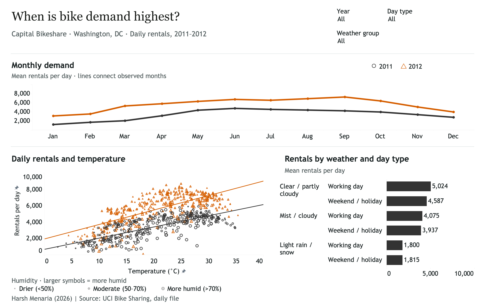
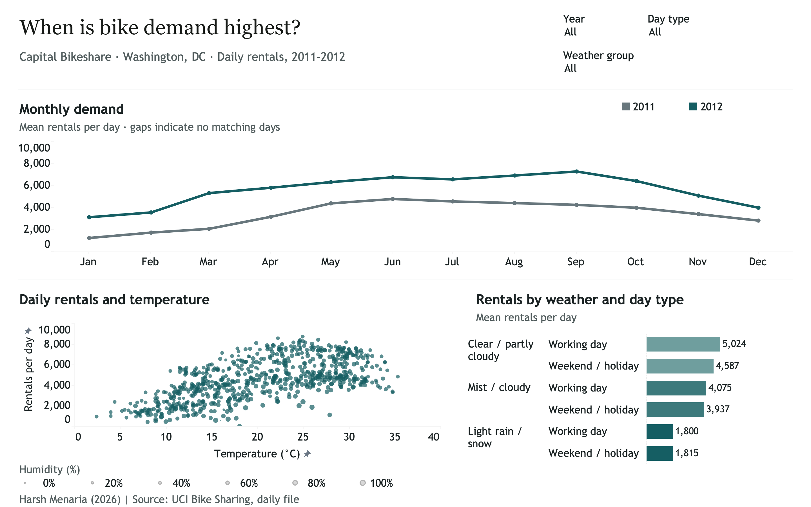
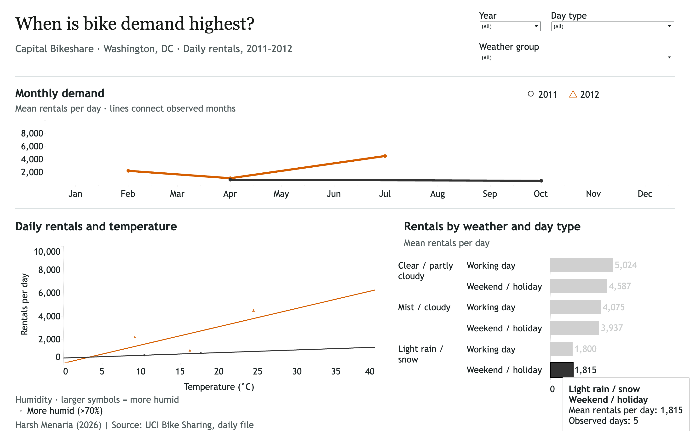
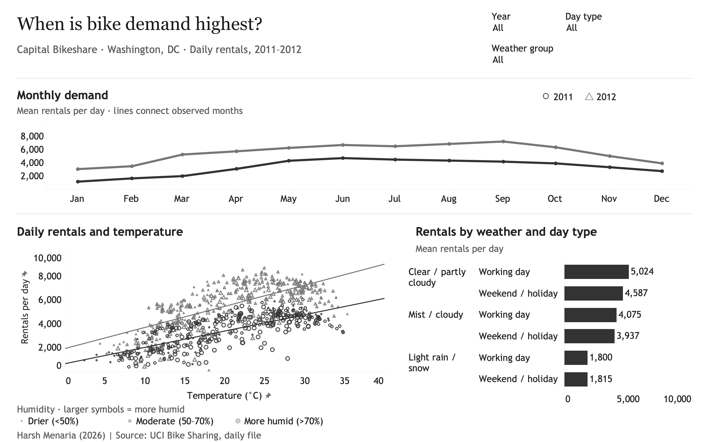
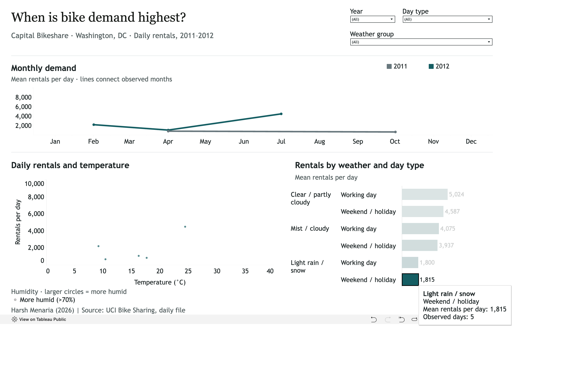

# Bike demand across time and weather

**Harsh Menaria · NYU Information Visualization · Project 2 prototype**

How do time of year, temperature, weather and day type relate to bike-rental demand? This interactive Tableau dashboard explores **731 days of Capital Bikeshare rentals in Washington, DC, during 2011–2012**, through three connected views.

## View the dashboard

### [Open the live interactive dashboard →](https://public.tableau.com/views/BikeDemandacrossTimeandWeather-Prototype/BikedemandPrototype?:showVizHome=no&:toolbar=yes)

**View it in your browser. No Tableau installation, account or sign-in is needed.** GitHub displays the documentation and screenshots; the filters, selections and tooltips work on Tableau Public.

Use a desktop or laptop for the full layout. If an edge is hidden, use Tableau's **Full Screen** control below the dashboard or zoom your browser out.

*Current overview. Select the preview above to open the live dashboard.*

## Try it in one minute

1. Open the live dashboard and start with all three filters set to **(All)**.
2. Change **Year** to **2012** in the upper right. All three charts update; the scatterplot shows only orange triangles, making individual days easier to inspect.
3. Hover over a daily point to see its date, rentals, temperature, humidity, weather and day type.
4. Return **Year** to **(All)**, then click the **Weekend / holiday** bar under **Light rain / snow**. The monthly chart and scatterplot update to the **five matching days**. Hover over the bar to see **1,815 mean rentals per day** and **5 observed days**.
5. Click empty plot space inside the weather chart to clear the selection. The other views return to the data allowed by your dropdown filters.

## What the interactions do

| Control or gesture | How to use it | What changes |
| --- | --- | --- |
| **Year** | Choose **2011**, **2012** or **(All)** | Filters all three charts; a single year reduces overlap |
| **Day type** | Use the checkboxes to select working days and/or weekends/holidays | Filters all three charts |
| **Weather group** | Use the checkboxes to select clear, mist/cloudy and/or light rain/snow days | Filters all three charts |
| **Select a weather bar** | Click one of the six horizontal bars | Filters the monthly chart and scatterplot to that weather/day-type group; the weather chart keeps its comparison rows and dims the other bars |
| **Clear a bar selection** | Click blank plot space inside the weather chart | Removes the chart selection while keeping your dropdown filters |
| **Hover over a mark** | Pause over a line point, daily symbol or bar | Shows exact values; monthly points and bars also show how many days contribute to their mean |

The dropdown filters work together. **To reset everything:** clear any weather-bar selection, then set Year, Day type and Weather group to **(All)**. The year key explains the colors and shapes; use the **Year dropdown** to filter.

## How to read the three views

| View | What each mark represents | What to compare |
| --- | --- | --- |
| **Monthly demand** | One month's **mean rentals per day**, with one line per year | Seasonal patterns and the difference between 2011 and 2012 |
| **Daily rentals and temperature** | One day: temperature on the horizontal axis and rentals on the vertical axis | Temperature/demand patterns; larger symbols indicate a higher humidity band |
| **Rentals by weather and day type** | **Mean rentals per day** for one weather/day-type group | Working days versus weekends/holidays within each weather group |

**2011 = tungsten black; 2012 = orange.** The scatterplot also uses **circles for 2011** and **triangles for 2012**. Weather bars are uniformly black; their color does not represent a year. The Year filter controls which years contribute to those means.

Monthly lines connect observed means, including across months without matching days; a gap is never treated as zero. “Observed days” is the sample count behind an average, not the number of rentals. The rain/weekend example has only five days, so it should not be treated as a reliable general weekend effect. Trendlines describe associations rather than causes or forecasts.

## Screenshots and feedback

### Before feedback → after feedback

Raz and Maria said the sequential colors were not distinct enough and the monthly chart needed to distinguish the two years more clearly. **I already acted on that feedback in the current prototype.** These screenshots show the earlier design and the completed revision; select either image to view it at full size.

| Before feedback — earlier prototype | After feedback — current revised prototype |
| --- | --- |
|  |  |

### What I changed and why

| Area | Change already completed | Why I changed it |
| --- | --- | --- |
| **Year colors** | Replaced the slate/teal comparison with **tungsten black for 2011** and **orange for 2012** in the monthly and daily views | Make the two years easier to distinguish and keep their meaning consistent across views |
| **Scatterplot shapes** | Replaced the single circle style with **circles for 2011** and **triangles for 2012** | Provide a second year cue beyond color, including in grayscale |
| **Year selection** | Made the shared Year control a single-select **(All) / 2011 / 2012** dropdown | Let readers reduce overlap and inspect one year across all three charts |
| **Weather bars and numbers** | Retained the six original mean bars, changed them to **solid black**, and kept their values in clear space after each bar | Emphasize the length comparison and keep the numbers readable |
| **Visual check** | Inspected a grayscale version of the revised dashboard | Check that the year distinction still works when hue is removed |

The revision preserves the same 731 daily records and the three-view layout. The [feedback log](feedback_log.txt) separates the feedback received, the changes already made and my own future plans.

### Current submission screenshots

Use the [revised overview](Screenshots/03_revised_overview.png) and [revised linked selection](Screenshots/04_revised_linked_selection.png). The example below shows the current prototype responding to a bar selection, with its actual tooltip.

### Next: version 3 — planned improvements

**Version 3 comes after this revised prototype; these analytical improvements are still planned.** Reflecting on the project's purpose, I noticed that I can use the data more fully to develop one clearer overall insight. I plan to compare grouped daily averages by year, weather and rider type around the story of demand growth, and explore additional compatible data if it adds useful context. This is my own reflection, separate from the feedback I already addressed. The [feasibility notes](docs/DATA_AND_DESIGN.md#my-own-reflection-and-plan-for-version-3) explain what the current data supports.

View the grayscale check

This diagnostic was derived from the revised native Tableau export and visually inspected. The year lines retain different lightness and the scatterplot retains different shapes.

View the earlier linked-selection screenshot — preserved before the feedback changes

This earlier interaction screenshot and the before-feedback overview above are preserved to document progress. The revised screenshots show the current design.

## Open the workbook locally

For viewing, the browser link above is enough. To inspect or edit the native workbook:

1. [Download the packaged Tableau workbook](https://github.com/Hmena01/bike-demand-tableau-prototype/raw/refs/heads/main/menaria_harsh_bike_demand_prototype.twbx).
2. Open the downloaded `.twbx` in Tableau Desktop or Tableau Public desktop. It was authored in **Tableau Desktop 2026.2.2**; use that version or a compatible newer version.
3. Select the **Bike demand | Prototype** dashboard tab.

All 731 daily records are embedded in the workbook. No external spreadsheet connection, Python setup, API key or data refresh is needed to open it. GitHub cannot run the `.twbx` as an interactive dashboard.

## Data and project documentation

Source: Fanaee-T, H. (2013), *Bike Sharing*, [UCI Machine Learning Repository](https://doi.org/10.24432/C5W894). The original daily records are preserved; no days were sampled, deleted or imputed.

| Resource | Contents |
| --- | --- |
| [Data, design and verification notes](docs/DATA_AND_DESIGN.md) | Research encodings, Q/O/N field types, calculations, source checks and limitations |
| [Original source data](Source/) | Supplied daily CSV and dataset Readme |
| [Prepared data](Data/) | Typed CSV and Excel files |
| [Feedback log](feedback_log.txt) | Raz and Maria's feedback and the response |

This is a working prototype for class feedback. Full reciprocal brushing, formal accessibility tuning and human usability testing remain final-submission work.
